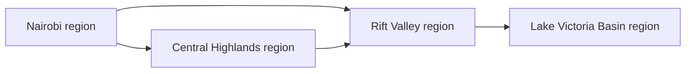
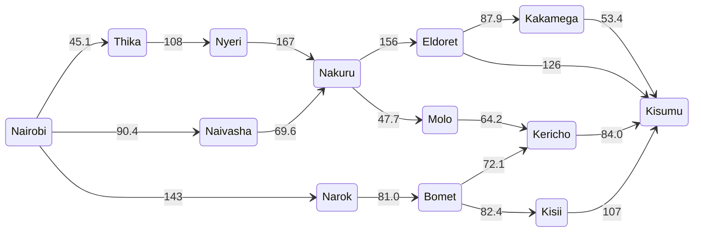
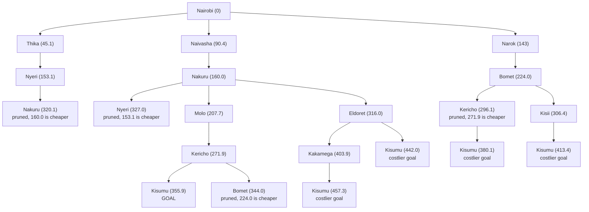

# ICS 3202: Artificial Intelligence
## Practical Exercise 3: Designing a Searching Agent

**Class:** ICS_3A

| No. | Name | Admission No. |
|-----|------|---------------|
| 1 | Seyianoi Sankok | 190384 |
| 2 | Annie Wanjohi | 171001 |

---

## Evidence of Group Work

## Question 1

### 1.1 PEAS description of the self driving trailer

The agent is a self driving trailer that carries cargo from Nairobi to Kisumu along Kenyan highways.

| Component | Description |
|-----------|-------------|
| Performance measure | Cargo arrives safely, the distance covered is as short as possible, the trip takes the least time and uses little fuel |
| Environment | Highways, towns, traffic laws, other vehicles, pedestrians, animals and the weather |
| Actuators | Steering wheel, accelerator, brake, horn, indicators |
| Sensors | Cameras, GPS, sonar, radar, speedometer, fuel gauge |

### 1.2 Environment of the trailer

**Partially observable.** The trailer's sensors only pick up what is close to it. It cannot see around a bend or know what another driver plans to do, so it has to make informed guesses about the road ahead.

**Stochastic.** The next state of the road does not depend only on the trailer's own action. Rain, potholes, a breakdown or a matatu cutting in are all outside its control. The same action can give a different result on a different day.

**Sequential.** What the trailer does now depends on what it did before. The route it picked and the fuel it has already used affect the choices it has left on the way to Kisumu.

**Dynamic.** The environment keeps changing while the trailer is still deciding what to do. Vehicles move, lights change and the weather shifts.

**Multiagent.** The trailer is not alone on the road. Other drivers, pedestrians and vehicles are also acting in the same space, and the trailer must respond to them.

---

## Question 2

### 2.1 Problem formulation

- **Goal:** get the trailer from Nairobi to Kisumu using the least distance.
- **State:** the town the trailer is in, written as In(town).
- **Initial state:** In(Nairobi)
- **Actions:** Go(next town), for any town joined to the current town by a highway.
- **Transition model:** Result(In(A), Go(B)) = In(B)
- **Goal test:** is the trailer in Kisumu?
- **Path cost:** the sum of the road distances in km.

### 2.2 Abstraction

The real road network has far too much detail to search. So we throw away what the search does not need and keep only what it does.

What we ignore: lanes, junctions, traffic, weather, tolls, fuel stops and small villages. What we keep: the main towns and the distance between neighbouring ones.

This gives two levels.

**Level 1, regions.** At the top, each region is a single state. This is enough to see that the Central Highlands is a long way round, and that the trailer must pass through the Rift Valley to reach the Lake Victoria Basin.

**Level 2, towns.** Each region is opened up into its towns. A state is now one town, and an action is a drive from that town to the next one on the highway.

| Region | Towns used |
|--------|------------|
| Nairobi | Nairobi |
| Central Highlands | Thika, Nyeri |
| Rift Valley | Naivasha, Nakuru, Molo, Kericho, Eldoret, Narok, Bomet |
| Lake Victoria Basin | Kisumu, Kisii, Kakamega |

Towns that sit on the road between two of these, like Gilgil or Maai Mahiu, are folded into the road. They do not become states of their own.

### 2.3 Distances between towns

All distances come from the Google Maps driving directions. Maps often shows more than one route between two towns. Since our path cost is distance, we took the **shortest route in km** for every pair and used the same rule throughout.

| From | To | Distance (km) |
|------|----|---------------|
| Nairobi | Thika | 45.1 |
| Nairobi | Naivasha | 90.4 |
| Nairobi | Narok | 143 |
| Thika | Nyeri | 108 |
| Nyeri | Nakuru | 167 |
| Naivasha | Nakuru | 69.6 |
| Nakuru | Molo | 47.7 |
| Nakuru | Eldoret | 156 |
| Molo | Kericho | 64.2 |
| Kericho | Kisumu | 84.0 |
| Narok | Bomet | 81.0 |
| Bomet | Kericho | 72.1 |
| Bomet | Kisii | 82.4 |
| Kisii | Kisumu | 107 |
| Eldoret | Kakamega | 87.9 |
| Eldoret | Kisumu | 126 |
| Kakamega | Kisumu | 53.4 |

### 2.4 Directed graph

Each town is a state and each arrow is a road the trailer can take. The number on an arrow is the distance in km. Every highway can be driven both ways, but to keep the diagram clear only the arrows pointing away from Nairobi are drawn. The arrows back towards Nairobi have the same distances.

### 2.5 Search tree

The tree starts at the initial state, In(Nairobi), and grows by adding every town the trailer can drive to next. The number in brackets is g(n), the total distance in km from Nairobi to that node.

Two rules were used while building it:

1. A branch never goes straight back to its parent. Without this the tree would loop forever, because the roads go both ways.
2. If a town is reached again by a longer path, the node is marked as pruned and not expanded. Another path already reached that town cheaper.

---

## Question 3

### 3.1 Method

The path cost is distance, so the search to use is **Uniform Cost Search (UCS)**. It always expands the path with the lowest total cost g(n) first, using a frontier ordered by g. It does not stop when a goal is first generated. It stops when the goal is picked for expansion, because by then no cheaper path can still be waiting in the frontier.

### 3.2 Trace

| Step | Node expanded | g (km) | New paths added to the frontier |
|------|---------------|--------|---------------------------------|
| 1 | Nairobi | 0 | Thika 45.1, Naivasha 90.4, Narok 143 |
| 2 | Thika | 45.1 | Nyeri 153.1 |
| 3 | Naivasha | 90.4 | Nakuru 160.0 |
| 4 | Narok | 143 | Bomet 224.0 |
| 5 | Nyeri | 153.1 | Nakuru 320.1 (dropped, 160.0 is cheaper) |
| 6 | Nakuru | 160.0 | Molo 207.7, Eldoret 316.0 |
| 7 | Molo | 207.7 | Kericho 271.9 |
| 8 | Bomet | 224.0 | Kericho 296.1 (dropped, 271.9 is cheaper), Kisii 306.4 |
| 9 | Kericho | 271.9 | Kisumu 355.9 |
| 10 | Kisii | 306.4 | Kisumu 413.4 (dropped, 355.9 is cheaper) |
| 11 | Eldoret | 316.0 | Kakamega 403.9, Kisumu 442.0 (dropped) |
| 12 | Kisumu | 355.9 | Goal reached, search stops |

### 3.3 Routes compared

| Route | Calculation | Total (km) |
|-------|-------------|------------|
| Nairobi, Naivasha, Nakuru, Molo, Kericho, Kisumu | 90.4 + 69.6 + 47.7 + 64.2 + 84.0 | **355.9** |
| Nairobi, Narok, Bomet, Kericho, Kisumu | 143 + 81.0 + 72.1 + 84.0 | 380.1 |
| Nairobi, Narok, Bomet, Kisii, Kisumu | 143 + 81.0 + 82.4 + 107 | 413.4 |
| Nairobi, Naivasha, Nakuru, Eldoret, Kisumu | 90.4 + 69.6 + 156 + 126 | 442.0 |
| Nairobi, Naivasha, Nakuru, Eldoret, Kakamega, Kisumu | 90.4 + 69.6 + 156 + 87.9 + 53.4 | 457.3 |
| Nairobi, Thika, Nyeri, Nakuru, Molo, Kericho, Kisumu | 45.1 + 108 + 167 + 47.7 + 64.2 + 84.0 | 516.0 |

### 3.4 Answer

The optimal path from Nairobi to Kisumu is:

**Nairobi → Naivasha → Nakuru → Molo → Kericho → Kisumu**

**Total path cost = 90.4 + 69.6 + 47.7 + 64.2 + 84.0 = 355.9 km**

This path is 24.2 km shorter than the next best one, which goes through Narok and Bomet (380.1 km). The route through the Central Highlands is the longest at 516.0 km because it takes the trailer far north before it comes back to Nakuru.

UCS is complete and optimal here. The graph is finite and every distance is positive, so the first time Kisumu is expanded, we know the path to it is the cheapest one.

One limit to note: the cost is distance only. A route with the fewest km might not be the fastest, because traffic, tolls and the state of the road are not part of the cost.
