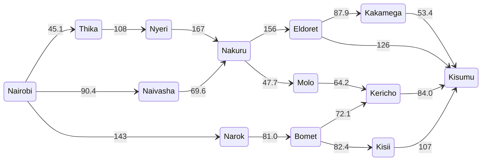
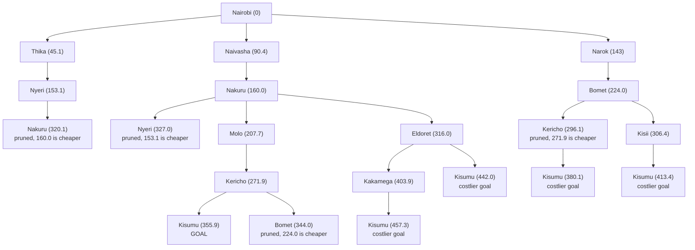

# ICS 3202: Artificial Intelligence
## Practical Exercise 3: Designing a Searching Agent

**Class:** ICS_3A

| No. | Name | Admission No. |
|-----|------|---------------|
| 1 | Seyianoi Sankok | 190384 |
| 2 | Annie Wanjohi | 171001 |

---

## Evidence of Group Work

## Question 1

### PEAS Framework:

| Component | Description |
|-----------|-------------|
| Performance measure | Cargo arrives safely, the distance covered is as short as possible, the trip takes the least time and uses little fuel |
| Environment | Highways, towns, traffic laws, other vehicles, pedestrians, animals and the weather |
| Actuators | Steering wheel, accelerator, brake, horn, indicators |
| Sensors | Cameras, GPS, sonar, radar, speedometer, fuel gauge |

### Agents environment:

**i. Partially observable:** The trailer's sensors only pick up what is close to it. It cannot see around a bend or know what another driver plans to do, so it has to make informed guesses about the road ahead.

**ii. Stochastic:** The next state of the road does not depend only on the trailer's own action. Rain, potholes, a breakdown or a matatu cutting in are all outside its control. The same action can give a different result on a different day.

**iii. Sequential:** What the trailer does now depends on what it did before. The route it picked and the fuel it has already used affect the choices it has left on the way to Kisumu.

**iv. Dynamic:** The environment keeps changing while the trailer is still deciding what to do. Vehicles move, lights change and the weather shifts.

**v. Multiagent:** The trailer is not alone on the road. Other drivers, pedestrians and vehicles are also acting in the same space, and the trailer must respond to them.

---

## Question 2

### Abstraction

Only the main towns on the highways between Nairobi and Kisumu were kept as states. Small roads, trading centres, road width, traffic and weather were removed, because the route only depends on which towns connect and how far apart they are.

| Region | Towns used |
|--------|------------|
| Nairobi | Nairobi |
| Central Highlands | Thika, Nyeri |
| Rift Valley | Naivasha, Nakuru, Molo, Kericho, Eldoret, Narok, Bomet |
| Lake Victoria Basin | Kisumu, Kisii, Kakamega |

### Distances between towns

| From | To | Distance (km) |
|------|----|---------------|
| Nairobi | Thika | 45.1 |
| Nairobi | Naivasha | 90.4 |
| Nairobi | Narok | 143 |
| Thika | Nyeri | 108 |
| Nyeri | Nakuru | 167 |
| Naivasha | Nakuru | 69.6 |
| Nakuru | Molo | 47.7 |
| Nakuru | Eldoret | 156 |
| Molo | Kericho | 64.2 |
| Kericho | Kisumu | 84.0 |
| Narok | Bomet | 81.0 |
| Bomet | Kericho | 72.1 |
| Bomet | Kisii | 82.4 |
| Kisii | Kisumu | 107 |
| Eldoret | Kakamega | 87.9 |
| Eldoret | Kisumu | 126 |
| Kakamega | Kisumu | 53.4 |

### Directed graph

Note: since roads run both ways, a few roads are reversed (Nakuru to Nyeri and Kericho to Bomet), and since they are eliminated it does not affect the results

### Search tree

---

## Question 3

| Step | Node expanded | g (km) | New paths added to the frontier |
|------|---------------|--------|---------------------------------|
| 1 | Nairobi | 0 | Thika 45.1, Naivasha 90.4, Narok 143 |
| 2 | Thika | 45.1 | Nyeri 153.1 |
| 3 | Naivasha | 90.4 | Nakuru 160.0 |
| 4 | Narok | 143 | Bomet 224.0 |
| 5 | Nyeri | 153.1 | Nakuru 320.1 (dropped, 160.0 is cheaper) |
| 6 | Nakuru | 160.0 | Molo 207.7, Eldoret 316.0 |
| 7 | Molo | 207.7 | Kericho 271.9 |
| 8 | Bomet | 224.0 | Kericho 296.1 (dropped, 271.9 is cheaper), Kisii 306.4 |
| 9 | Kericho | 271.9 | Kisumu 355.9 |
| 10 | Kisii | 306.4 | Kisumu 413.4 (dropped, 355.9 is cheaper) |
| 11 | Eldoret | 316.0 | Kakamega 403.9, Kisumu 442.0 (dropped) |
| 12 | Kisumu | 355.9 | Goal reached, search stops |

| Route | Calculation | Total (km) |
|-------|-------------|------------|
| Nairobi, Naivasha, Nakuru, Molo, Kericho, Kisumu | 90.4 + 69.6 + 47.7 + 64.2 + 84.0 | **355.9** |
| Nairobi, Narok, Bomet, Kericho, Kisumu | 143 + 81.0 + 72.1 + 84.0 | 380.1 |
| Nairobi, Narok, Bomet, Kisii, Kisumu | 143 + 81.0 + 82.4 + 107 | 413.4 |
| Nairobi, Naivasha, Nakuru, Eldoret, Kisumu | 90.4 + 69.6 + 156 + 126 | 442.0 |
| Nairobi, Naivasha, Nakuru, Eldoret, Kakamega, Kisumu | 90.4 + 69.6 + 156 + 87.9 + 53.4 | 457.3 |
| Nairobi, Thika, Nyeri, Nakuru, Molo, Kericho, Kisumu | 45.1 + 108 + 167 + 47.7 + 64.2 + 84.0 | 516.0 |

The optimal path from Nairobi to Kisumu is:
**Nairobi → Naivasha → Nakuru → Molo → Kericho → Kisumu**
**Total path cost = 90.4 + 69.6 + 47.7 + 64.2 + 84.0 = 355.9 km**

Limit: the cost is distance only therefore a route with the fewest km might not be the fastest, because traffic, tolls and the state of the road are not part of the cost.
